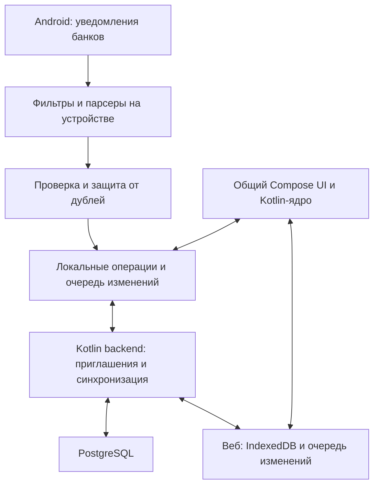

# Архитектура приложения «Ладно»

Проектное имя можно изменить. Версия документа: 17.11.2026. Документ описывает архитектуру приложения и проектный план. Источники ограничений платформ перечислены в `docs/SOURCES.md`.

## 1. Цель и границы

Приложение помогает автоматически учитывать операции, соблюдать бюджет на день, неделю и месяц и находить конкретные способы сокращать расходы. Основной сценарий: банковское уведомление → проверенная операция → изменение бюджета → понятное объяснение остатка.

Стартовые платформы: Android и веб на Compose Multiplatform. Основной пользователь — физическое лицо; база валюты RUB, русский интерфейс, часовой пояс Europe/Moscow по умолчанию с возможностью выбора. Обязательная архитектура offline-first. Первый вход выполняется онлайн по одноразовому коду приглашения, выданному администратором. После активации операции, счета, карты, иконки, бюджет и анализ работают без сети; синхронизация восстанавливается позже. Открытой регистрации, паролей и гостевого входа нет. У каждого пользователя отдельные данные; семейное совместное редактирование не входит в этот месячный план.

| Возможность | Android | Веб | iOS, если добавлять позже |
|---|---|---|---|
| Чтение уведомлений банков | Через NotificationListenerService после включения доступа пользователем | Недоступно; веб получает операции через синхронизацию | Общедоступного аналога Android listener для чужих приложений нет |
| Ручной ввод, категории, поиск | Да, офлайн | Да, офлайн после загрузки приложения | Общее ядро пригодно; нужен отдельный платформенный адаптер |
| Бюджеты и аналитика | Общее Kotlin-ядро | То же ядро | То же ядро |
| Локальное хранилище | Room/SQLite в Android-адаптере | IndexedDB через небольшой JS interop адаптер | Выбирается при фактическом добавлении iOS |
| Обмен между устройствами | Сервер, когда доступна сеть | Сервер, пока приложение открыто | Сервер |

Уведомления не являются банковской выпиской. История до установки автоматически не восстанавливается. После переподключения можно повторно обработать только ещё активные уведомления. Пропущенные, выключенные и скрытые банком уведомления требуют ручного ввода или CSV-импорта. Банковских балансов в модели и интерфейсе вообще нет: «осталось» означает только остаток расходов по плану.

## 2. Состав продукта

| Область | Результат |
|---|---|
| Обзор | Расходы за период, остаток бюджета, ориентир дня, обязательные платежи, статус полноты данных |
| Счета и карты | Отдельные счета и карты, несколько карт на один счёт, банковские и пользовательские иконки; без банковских балансов |
| Операции | Доход, расход, возврат, внутренний перевод; редактирование, разделение по категориям, заметки и теги |
| Фильтры | Даты, тип, категория, счёт, диапазон суммы, продавец, теги, источник, статус проверки; сохранённые наборы |
| Уведомления | Выбор пакета, условия по тексту, исключения, диагностика, тест правила, управление автоподтверждением |
| Проверка | Неизвестный формат, неоднозначная сумма, возможный дубль, неполный перевод, скрытый текст |
| Бюджет | Месячный план, категории, обязательства, резерв, дневной и недельный ориентиры, опциональные дополнительные ограничения |
| Аналитика | Расходы по дням и категориям, план/факт, сравнение одинаковых интервалов, продавцы, повторяющиеся платежи |
| Сокращение расходов | Объяснимые рекомендации, сценарий «если сократить», цель, отдельный учёт подтверждённой экономии |
| Данные | CSV-импорт с предпросмотром, CSV/JSON-экспорт, резервная копия, восстановление, удаление |
| Настройки | Тема, зона, начало недели, перенос остатка, подключённые устройства, приватность |
| Администрирование | Отдельный экран только для admin: выпуск приглашений, подключение устройств, отзыв кодов и сессий |

Подписка/платёж обнаруживается как кандидат, затем подтверждается пользователем. Разовый одинаковый платёж не объявляется подпиской. Советы рассчитываются локальными правилами. Внешняя языковая модель для работы продукта не нужна.

## 3. Общая схема

Приложение сначала сохраняет изменение локально. UI наблюдает локальные данные через Flow. Синхронизация выполняет обмен изменениями и обновляет локальную проекцию. Сырые временные уведомления остаются на Android. Все долговременные данные синхронизируются с сервером в зашифрованном виде. Веб получает и локально расшифровывает нормализованные операции и настройки бюджета, но не доступ к системным уведомлениям телефона.

## 4. Технологии и модули

| Слой | Выбор | Причина |
|---|---|---|
| Общая логика | Kotlin Multiplatform, Coroutines, Flow, kotlinx.serialization, kotlinx.datetime | Единые правила вычислений и состояния |
| UI | Compose Multiplatform, Material 3 Expressive, общие ресурсы | Общая визуальная система Android и веба |
| Состояние | MVVM с однонаправленным потоком: action → use case → repository → state | Простая трассировка изменений |
| DI | Явный AppContainer и конструкторы | Небольшой проект, зависимости видны без магии |
| Навигация | Мультиплатформенная Navigation Compose совместимой версии | Android back и адреса страниц в браузере; проверить реальный web history |
| HTTP клиента | Ktor Client | Общий сетевой слой; версию/движки проверить на Wasm в bootstrap |
| Android | Отдельный Android application module; Room; WorkManager; Keystore | Системный сбор, надёжная локальная БД, отложенная синхронизация |
| Web | Kotlin/Wasm; IndexedDB; service worker для app shell | Локальное редактирование и кеширование приложения |
| Сервер | Kotlin/JVM на JDK 21 LTS, совместимая Spring Boot, Spring Security, JDBC, Flyway | Kotlin на всех слоях, одна база и прозрачные транзакции |
| БД сервера | PostgreSQL | Encrypted records, metadata constraints, миграции, журнал изменений |
| Графики | Небольшие общие Canvas-компоненты + текстовая таблица | Только необходимые line/bar/donut; контролируемая доступность |
| Доставка | Docker Compose: API + PostgreSQL + reverse proxy/static web | Достаточно для личной беты и небольшого сервера |

Не фиксировать версии по памяти. Первая задача должна проверить совместимость Kotlin/Compose/AGP/Gradle/JDK, Material3 Expressive, Ktor и Wasm. На момент исследования документация JetBrains уже содержит Compose 1.12.2; это ориентир проверки, не готовый проверенный version catalog. Material3 имеет отдельный цикл версий. Экспериментальные API изолировать в `designsystem`, зафиксировать точные версии после успешных сборок Android и Wasm. Не подменять Expressive обычной темой без записи причины.

Room не является предположением о единой БД для всех целей. Общий код зависит от интерфейсов, Android реализует их через Room, браузер — через IndexedDB. Это избегает непроверенного предположения «SQLite автоматически работает в Wasm».

### Структура репозитория

| Путь | Назначение |
|---|---|
| `androidApp/` | Activity, manifest, разрешения, platform composition root |
| `webApp/` | Wasm entry point, route integration, web adapters, PWA shell |
| `shared/domain/` | Money, сущности, порты, чистые use cases |
| `shared/engine/` | Парсеры, категоризация, бюджеты, аналитика, эвристики экономии |
| `shared/data/` | Репозитории, сериализация, sync coordinator, общий in-memory fake только для тестов/demo |
| `shared/ui/` | Экраны и ViewModel; подпакеты dashboard/transactions/budgets/insights/sources/settings |
| `shared/designsystem/` | Theme, tokens, выразительные компоненты, доступные графики |
| `platform/android/` | Listener, Room, WorkManager, secure session storage |
| `server/` | Kotlin/JVM backend в общей Gradle-сборке; opaque sync, приглашения, devices, assets |
| `contracts/` | OpenAPI, JSON Schema, общие golden JSON fixtures |
| `test-fixtures/` | Синтетические уведомления, ожидаемые операции, примеры CSV |
| `infra/` | Docker Compose, proxy, backup/restore, env.example без секретов |
| `docs/` | Решения, совместимость, статус, доказательства проверок |

`shared/domain` не импортирует Android, Compose, Room и Spring. `shared/engine` зависит от domain. UI вызывает use cases, не DAO и HTTP. Backend переиспользует только общие transport contracts; бизнес-инварианты открытых финансов проверяются клиентами, потому что сервер хранит E2EE ciphertext. UI-модули не подключаются. HTTP-контракт согласуется через OpenAPI и fixtures. На клиенте и сервере — `Long` с точной проверкой переполнения, в JSON — строковые целые minor units.

Не создавать отдельный Gradle-модуль для каждого экрана. Это 6 основных общих/платформенных модулей плюс entry points и сервер; дробить дальше только при реальной необходимости.

## 5. Модель данных

Каждая синхронизируемая сущность имеет UUID, serverRevision, deletedAt и локальные syncState/lastAcknowledgedRevision. Владелец определяется серверной сессией. Переданный клиентом userId никогда не является основанием доступа.

| Сущность | Основные поля и правила |
|---|---|
| BankProfile | id, displayName, builtInIconKey?, customIconAssetId?; например ОТП Банк, Альфа-Банк; название не определяет packageName |
| Account | id, name, bankProfileId?, currency, kind: debit/credit/cash, iconOverride?; полей баланса нет |
| Card | id, accountId, name, last4?, paymentSystem?, iconOverride?, archivedAt?; своего баланса нет; один счёт содержит несколько карт |
| IconAsset | id, sha256, mime, width, height, localBlobKey, uploadState; синхронизируется отдельно от финансовых агрегатов |
| Transaction | id, kind, amountMinor > 0, currency, accountId, cardId?, counterpartyAccountId?, occurredAt, capturedAt?, budgetDate, zoneAtAssignment, merchant?, note?, source, reviewStatus, splits[], tags[], excludedFromBudget |
| TransactionSplit | categoryId, amountMinor; сумма частей точно равна сумме расхода/возврата |
| Category | id, name, parentId?, iconKey, colorToken, fixedOrVariableDefault |
| RefundLink | refundId, originalExpenseId?, allocatedMinor; валюта совпадает; частичный возврат разрешён |
| TransferLink | одна операция с двумя счетами одной валюты; входящий/исходящий push привязываются как evidence к одному агрегату |
| NotificationSource | deviceId, packageName, channelId?, enabled, includeAny[], includeAll[], excludeAny[], parserProfileId, autoConfirm |
| IngestionEvent | локальный id, transportKey, payloadDigest, receivedAt, parserVersion, resultCode, transactionId?; сырой текст хранится отдельно и временно |
| CategoryRule | priority, conditions, targetCategory, targetMerchant?, enabled; ручная категория имеет приоритет |
| BudgetMonth | month, zoneId, currency, expenseLimitMinor, reserveMinor, rolloverPolicy, version |
| BudgetCategory | monthId, categoryId, allocatedMinor, protected, rolloverPolicy |
| PlannedPayment | schedule, expectedMinor, categoryId, accountId?, matchedTransactionId?, state: upcoming/paid/skipped; ожидаемый платёж не является фактическим расходом |
| BudgetCap | kind: day/week, startDate, endDateExclusive, categoryId?, limitMinor; дополнительное ограничение, не новые деньги |
| Goal | name, targetMinor, deadline?, allocatedMinor, confirmedContributions; перевод в накопления не является потребительским расходом |
| ReviewItem | reason, candidateFields, evidenceLocalId?, resolution, linkedTransactionId? |
| SavedFilter | name, version, filterExpression; одинаковая семантика Android/веб |
| OutboxCommand | commandId, entityId, baseRevision, operation, payload, attempt, state; хранится атомарно с пользовательским изменением |
| SyncConflict | entityId, baseRevision, localValue, serverValue, reason; требуется явное разрешение |

Суммы не хранятся в Float/Double. Вход `1 234,56 ₽` преобразуется в `123456` копеек. Запрещены молчаливое округление и число знаков после запятой сверх precision валюты. JSON amountMinor/revision/cursor — десятичные строки. Для процентов и графических координат Double допустим только после расчёта точной суммы. В открытой логической модели — целые с проверками диапазона; при E2EE persisted суммы находятся внутри encrypted payload, а не в открытых BIGINT columns. Другие валюты отображать отдельно; до реализации FX нельзя суммировать RUB и USD.

Тип и reviewStatus независимы: confirmed expense входит в бюджет, pending candidate — только в список проверки и отдельную строку «ещё не учтено». Удаление — tombstone, история изменений ограничена метаданными и предыдущими структурированными значениями без сырого push.

Дата бюджета фиксируется при подтверждении. Смена настройки зоны не перебрасывает прошлые операции между днями без отдельного предпросмотра и подтверждения. Для даты из уведомления без зоны применять профиль источника и помечать допущение; если даты нет, использовать время получения с соответствующей меткой.

### Счета, карты и иконки

Карта всегда привязана к одному счёту. Несколько карт одного счёта не создают несколько бюджетов. Операция содержит accountId и опционально cardId. При выборе карты приложение автоматически подставляет её счёт и проверяет валюту. В push последние четыре цифры сопоставляются только внутри выбранного банка/источника и известных карт. Совпадение last4 не является глобальным идентификатором. При неоднозначности требуется проверка. Если счёт определить нельзя, кандидат сохраняется во входящих до выбора счёта; банковский баланс для этого не нужен.

Смена привязки карты действует на новые операции. Старые accountId не переписываются; перенос истории — отдельное действие с предпросмотром. Архивирование карты или счёта сохраняет историю и фильтры. Физическое удаление используемого справочника запрещено, сначала архивирование. Внутренние переводы исключаются из расходов независимо от того, какие карты одного владельца участвовали. Погашение кредитной карты — внутренний перевод, если исходный расход уже учтён; комиссия — отдельный расход. Суммы переводов не используются для вычисления банковского остатка.

Приоритет иконок: override карты/счёта → custom icon банка → встроенная иконка банка → нейтральная иконка. Поддержать встроенные записи ОТП Банк и Альфа-Банк с официальными/разрешёнными ассетами либо нейтральными initials; кастомная картинка всегда доступна. Не объявлять самодельный знак официальным логотипом. Пользователь загружает PNG/JPEG/WebP; приложение локально декодирует, обрезает и уменьшает до 256×256, удаляет EXIF, сохраняет новый PNG/WebP до 256 КиБ. Сырые SVG и внешние URL не используются. Blob хранится локально и доступен офлайн, upload идёт отдельно; карточка операции не ждёт отправки иконки. При E2EE сервер проверяет размер ciphertext и owner; клиент повторно проверяет тип/размер/декодирование после расшифровки и выдаёт asset только в своём UI. Недоступный asset заменяется fallback без потери данных.

## 6. Сбор уведомлений

Подробная машина состояний и случаи проверки: `docs/INGESTION.md`.

1. Пользователь выбирает банковское приложение и правила по тексту. Доступ к уведомлениям включается на отдельном системном экране. Разрешение POST_NOTIFICATIONS относится к собственным напоминаниям приложения и не заменяет notification access.
2. Listener проверяет packageName по allowlist до чтения текста; остальные приложения не записываются и не отправляются. Собственные уведомления исключены.
3. Проверяется group summary, канал и ограничения размера. Для разрешённого пакета извлекаются title/text/bigText/textLines с устранением повторов полей.
4. Конверт помещается в локальный durable inbox; обработка не зависит от открытой Activity и не делает сеть в callback. Работа вне main thread, запись и обработка ограничены по времени и размеру.
5. Сначала дедупликация доставки, затем фильтры текста и версионированный parser profile. Извлекаются сумма операции, валюта, направление, продавец, маскированный идентификатор счёта и дата.
6. Уверенный результат создаёт confirmed transaction только для включённого пользователем автоподтверждения. Иначе открывается ReviewItem. Неизвестная сумма не считается нулевой.
7. В одной локальной транзакции сохраняются операция/ссылки на evidence/outbox. Бюджет обновляется реактивно. Фоновая синхронизация занимается только структурированными данными.

Нельзя выбирать первое найденное число: в push могут одновременно быть сумма покупки, баланс, последние цифры карты, бонусы и лимит. Парсер обязан найти маркер операции и отличить баланс. Профили банка включаются только после fixtures и теста на реальном обезличенном примере.

Фильтры уведомлений — безопасная DSL: поле + contains/equals/startsWith + AND/OR/NOT, case folding и нормализация пробелов. Пользовательского произвольного regex в первом месяце нет. Это сохраняет гибкость «пакет + уведомление» без небезопасного исполняемого правила.

Повторная доставка с тем же стабильным банковским operationId может связываться автоматически. Одинаковые сумма/магазин/минута создают лишь кандидата на дубль: две одинаковые покупки возможны. Повторные `onNotificationPosted` и изменение существующей карточки проверяются по transportKey и содержимому; один Android notification key может переиспользоваться банком для разных покупок.

## 7. Бюджет дня, недели, месяца

Полная математика и граничные случаи: `docs/BUDGET_RULES.md`.

Месяц — источник лимита. Категории распределяют его. Защищённые обязательные платежи и резерв уменьшают доступное на повседневные траты. День и неделя — проекции оставшегося ресурса и при необходимости дополнительные пользовательские cap, а не независимые кошельки.

| Период | Что показывает | Действия |
|---|---|---|
| День | Потрачено сегодня, ориентир остатка, влияние покупки | Перенести доступный остаток, установить cap, добавить запланированную трату |
| Неделя | План/факт по дням, обязательства недели, прогноз до воскресенья | Перераспределить дневные доли, поставить cap; начало недели настраивается |
| Месяц | Общий лимит, категории, обязательства, резерв, прогноз перерасхода | Изменить план, резерв, правила переноса, подтвердить следующий месяц |

Пример на 17 ноября 2026, начало дня: лимит 32 000 ₽, потрачено до 17-го 18 000 ₽, неоплаченных обязательств нет, резерв 2 400 ₽. На повседневные траты остаётся 11 600 ₽ на 14 календарных дней, то есть базово 828,57 ₽ в день с распределением остатков копеек; для первого дня — 828,58 ₽. Общий остаток бюджета при этом 14 000 ₽. Два значения показываются с объяснением разницы. Если до воскресенья 6 дней, ориентир этой части недели — 6 дневных долей, точно 4 971,44 ₽; скользящий семидневный горизонт — 5 800,01 ₽. Деление месяца на четыре запрещено.

Новый расход уменьшает остаток в тот же день. Пересчёт базовой дневной доли происходит на границе дня; в течение дня не размывать перерасход повторным делением на число дней вместе с текущим. Возврат учитывается отдельной операцией по дате получения; связь с исходной покупкой доступна для аналитики. За прошлый месяц он не переписывает закрытый план молча.

При неполных данных показывать «по учтённым операциям», а не гарантировать наличие денег. Будущие доходы не увеличивают лимит автоматически. Приложение может предложить изменение плана после подтверждённого дохода.

## 8. Аналитика и рекомендации

Единый ExpenseQuery задаёт период [startDate, endDateExclusive), категорию, счета, merchant, теги, тип, источник, reviewStatus и диапазон суммы. Список, графики, totals и экспорт используют одну семантику фильтров. Графики строятся только по confirmed и включённым в бюджет операциям, возвраты отображаются отдельной серией/уменьшением net с ясной подписью.

| Представление | Правило |
|---|---|
| Расходы по дням | Столбцы actual + план; пустые дни с нулями; текущий день помечен неполным |
| Категории | Горизонтальные полосы или donut с точными суммами и таблицей |
| План/факт | Лимит, факт, остаётся, защищённая сумма; перерасход отдельно |
| Сравнение | Одинаковое число прошедших дней и одинаковые фильтры; процент не вычислять при нулевой базе |
| Продавцы | Сумма, число покупок, средний чек; нормализация merchant обратима |
| Прогноз | Известные будущие обязательства + темп переменных расходов; покрытие данных и допущения видны |
| Регулярные платежи | Кандидаты по нескольким периодам, похожей сумме и продавцу; подтверждение пользователем |

Совет содержит наблюдение, период, исходные суммы, предлагаемое действие и расчёт сценария. Например: «За 14 дней 8 покупок кофе на 2 400 ₽. Если сократить до 4, при том же среднем чеке разница составит 1 200 ₽ за 14 дней». Сценарий не выдаётся за уже сэкономленные деньги. Подтверждённая экономия — отдельное пользовательское действие либо сравнение с явно выбранной базой, с указанием ограничений.

Никаких оценок личности, стыда и тревожных красных экранов из-за покупки. Уведомления по лимитам можно отключать; по умолчанию не более одного нового предупреждения на категорию/порог/день. Полезнее понятное предложение «перераспределить 500 ₽», чем «вы снова потратили слишком много».

## 9. Синхронизация и сервер

Подробный протокол: `docs/SYNC_API.md`. Backend полностью на Kotlin/JVM — модульный монолит: identity/invitations, sync, banks/accounts/cards, icon-assets, transactions, budgets, rules, data-management. Основная финансовая логика и UI находятся в клиенте; сервер проверяет metadata контрактов и права и хранит encrypted records и канонические ревизии. Суммы, связи карт и остальные финансовые инварианты проверяются общим клиентским ядром до записи и после расшифровки.

Изменение агрегата выполняется атомарно; повтор команды с тем же commandId не создаёт вторую операцию. Состояние и outbox на клиенте записываются вместе. На сервере запись операции, idempotency receipt и change log — одна транзакция. Cursor упорядочен сервером, а не часами устройства. Конфликт concurrent edits не решается молчаливым last-write-wins: локальное изменение остаётся видимым с возможностью выбора версии.

Android отправляет изменения при открытии, после успешной записи, при ручном refresh и через WorkManager. Сеть и ОС могут задерживать фоновые задачи; обещание мгновенного межустройственного обновления не даётся. Веб синхронизируется при открытии, возвращении фокуса, online, ручном refresh и коротком опросе пока открыт. Закрытая вкладка не считается работающим сборщиком.

Первый онлайн-вход — обмен приглашения на привязку устройства и сессию. Администратор выпускает приглашение для нового пользователя или отдельное приглашение устройства к существующему аккаунту. Подробности: `docs/AUTH_AND_ADMIN.md`. После активации локальный доступ не требует валидного сетевого access token. Истечение сетевой сессии останавливает sync, но сохраняет локальный ввод и outbox. При следующем соединении приложение обновляет сессию или просит новый код подключения устройства, сохраняя данные текущего пользователя.

Данные изолированы по namespace userId; банковский Account — другая сущность. При выходе локальное хранилище блокируется; другой пользователь не получает старые операции. Неотправленные изменения не удаляются автоматически. Отзыв приглашения не отзывает уже созданную сессию: для этого есть отдельное действие администратора. Немедленно отозвать локальную работу устройства без сети невозможно.

Дополнительное обязательное проектное правило: локальные БД являются источником данных для UI, а не кешем сетевых ответов. Все изменяемые сущности, включая карты, правила, бюджеты и иконки, сохраняются локально вместе с очередью. Обновление приложения не очищает данные. Для веба реализуются IndexedDB migrations, service worker app shell, offline reload, запрос persistent storage, обработка quota errors и восстановление очереди после перезапуска. Браузер может отказать в persistence; это должно быть видно пользователю. Невозможно гарантировать сохранность несинхронизированных данных после очистки storage браузером.

## 10. Приватность и восстановление

| Данные | Где находятся | Политика |
|---|---|---|
| Сырой push | Только Android durable inbox/diagnostics | Доступные для разбора тексты автоматически удалять после обработки; для pending максимум 7 дней; диагностика raw выключена по умолчанию, включается отдельно на срок до 24 часов |
| Delivery hashes и связи | Локально Android | Без сырого текста; ограниченное окно хранения 30 дней; наличие банковского operationId позволяет более долгую точную связь |
| Операции, бюджеты, категории | Локальные encrypted records и синхронизированная encrypted серверная копия | Только данные владельца; экспорт/удаление доступны |
| Parser diagnostics | Счётчики и reason codes | Без текстов, номеров карт, продавцов, заметок и финансовых payload в логах |
| Сессия Android | Secure storage с Keystore | Паролей нет; отзыв сессии устройства администратором |
| Сессия Web | Secure HttpOnly cookie через тот же origin | Не хранить bearer token в localStorage; CSRF защита для изменений |
| IndexedDB | Encrypted records и wrapped keys в sandbox origin | Расшифрованные проекции в памяти; очистка браузера может уничтожить несинхронизированные данные |
| Резервная копия | По явному экспорту пользователем; серверные backups отдельно | Предупредить, если CSV/JSON открыт; зашифрованный backup — версионированный формат и стандартная криптобиблиотека |

Notification access технически даёт приложению широкую видимость. Объяснение до перехода в системные настройки должно честно сказать, что приложение обрабатывает только выбранные пакеты, хотя системный доступ шире. Не просить SMS, Accessibility или QUERY_ALL_PACKAGES для этого сценария. Список известных пакетов и `<queries>` проверяются по официальным источникам; пользователь может добавить точное имя пакета вручную. Не придумывать package ID банков по названию.

Для беты: TLS, безопасные cookies, хеширование одноразовых кодов приглашения, rate limits на активацию и API, owner isolation во всех запросах, CSRF, строгая CSP с проверкой реальной Wasm-сборки, запрет произвольного HTML из merchant/notes. Локальные records шифруются, ключ защищается Android Keystore/WebCrypto; биометрическая блокировка UI не заменяет шифрование. E2EE и восстановление ключа описаны в `docs/ENCRYPTION.md`. Полный SQLCipher не предполагается: шифруется payload записей, проекции для поиска находятся в памяти.

Сервер: ежедневный backup PostgreSQL с отдельным хранением, тест восстановления перед бетой, политика retention и удаления. Операции удаления аккаунта не должны воскресать через старую outbox устройства; сервер отзываёт устройства и ведёт epoch аккаунта. Эти требования реализуются задачами, а не только записываются в README.

## 11. Дизайн

Material 3 Expressive — основа компонентов, типографики и движения. Neumorphism используется как мягкая глубина только у крупных карточек и выбранных декоративных поверхностей. Human Design здесь трактуется как human-centered UX: ясные действия, спокойный тон, доступность и контроль пользователя. Композиции, состояния и компоненты описаны в `DESIGN.md`. Токены находятся в `DESIGN_TOKENS.json`, макеты — в `design/mobile_screens.svg`.

Обязательны светлая/тёмная темы, large fonts, контраст, клавиатура в вебе, TalkBack, reduce motion, графики с числовой альтернативой. Любой статус выражается текстом и иконкой, а не только цветом или тенью.

## 12. Реализация и приёмка

Задачи перечислены в `ROADMAP.md`, критерии проверок — в `docs/TEST_PLAN.md`.

Главные риски: доступность текста реального банка, повторные/изменённые уведомления, Wasm совместимость выбранных библиотек, долговечность браузерного хранилища, одинаковая математика периодов и конфликтующие изменения двух устройств. Их нужно проверять первыми, до полировки всех экранов.

Критерий месячной беты: на двух устройствах можно получить/проверить операцию, изменить категорию, видеть одинаковый бюджет, пережить offline/retry/conflict, экспортировать и восстановить данные. Поддержка банка заявляется только для реально проверенных форматов. Прохождение синтетических fixtures само по себе не доказывает поддержку банковского приложения.
